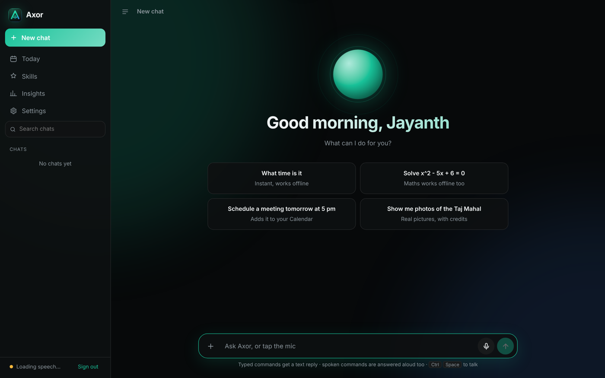
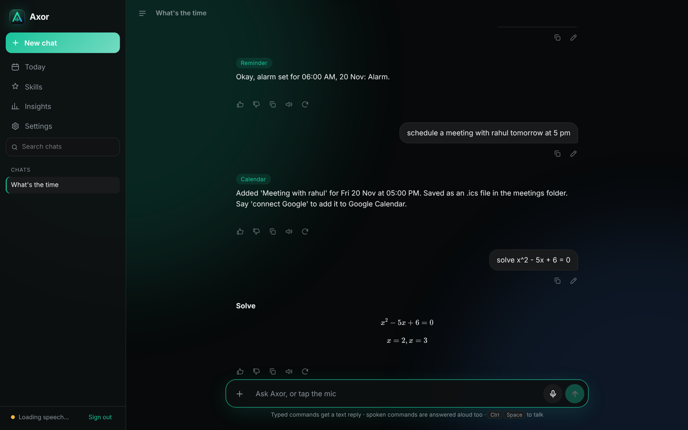
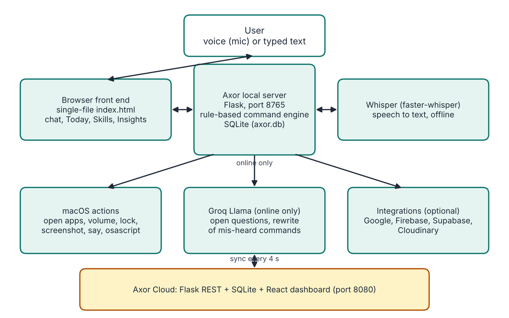
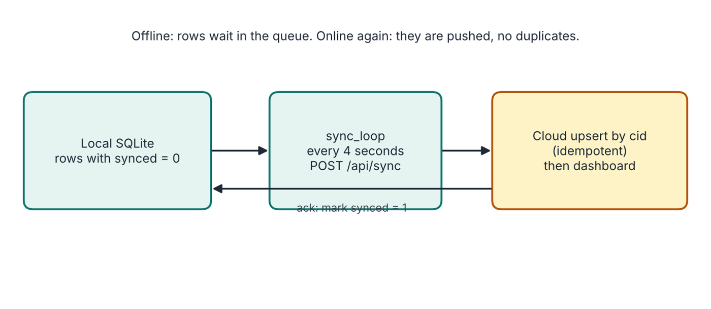
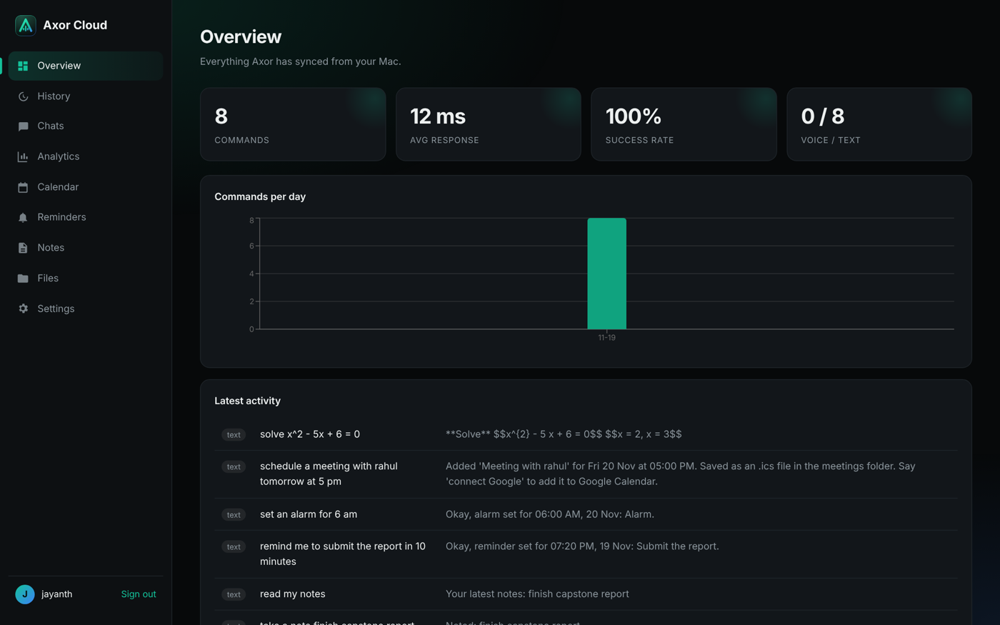
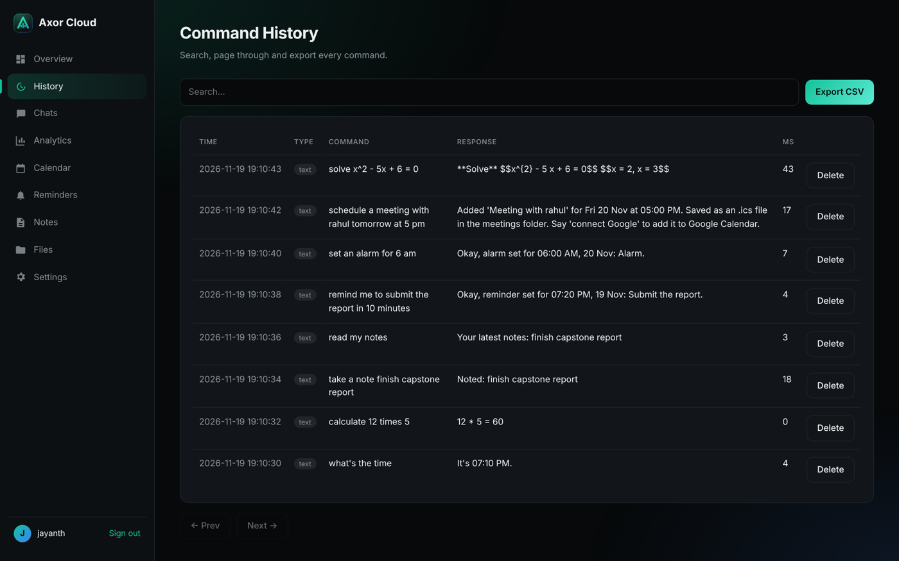

<div align="center">


# Axor

**i asked my assistant to set an alarm. the wifi was down. it did nothing.**

A voice assistant for macOS that keeps working offline.

    



</div>

---

## why this exists

every voice assistant i used did the same thing. my voice goes to a server, the server thinks, the answer comes back.

no internet, no assistant. and every request leaves my laptop.

but setting an alarm doesn't need a data centre. neither does "open Safari", "note this down" or "what's 12 times 5".

so we built Axor. the everyday commands run on your own machine. the internet is only used when a question really needs it.

built as our Capstone Project at VIT-AP University (CSBS).

---

## what it does

**works with no internet**

- opens apps and websites
- sets alarms, reminders and timers. they ring out loud, with a popup you can't miss
- takes notes and reads them back
- schedules meetings as `.ics` files
- solves maths: equations, derivatives, integrals, limits. shown as proper equations
- volume, lock screen, screenshot, battery, time, date
- listens to your voice with Whisper, on your own machine. your audio never leaves it

**needs internet, and tells you so**

- open questions and explanations (Groq Llama)
- photos with credits, sources, Gmail, Google Calendar
- cloud sync

if you're offline and ask something that needs the internet, Axor says so. it never pretends it did something it didn't.



---

## the part i'm happiest with

a lot of real use goes wrong in small ways.

speech recognition hears "set **and** alarm" instead of "set **an** alarm". a language model replies "done, alarm set" when nothing was set. "7.33 pm" gets read as 9 am tomorrow.

so most of the work wasn't new features. it was making the existing ones honest:

- sentences get cleaned before the rules run
- if the rules fail and you're online, a model rewrites the sentence once, and the rules try again
- if a model claims it did something, the claim is replaced with an honest message and an example that works
- alarms play a sound, speak, and show a popup

---

## how it works



1. you speak or type
2. Whisper turns speech into text on your machine
3. a rule-based engine cleans the sentence and runs the command
4. the result is saved to SQLite
5. every 4 seconds, anything not yet synced goes to Axor Cloud

work done offline waits in a queue. when the connection comes back, it syncs. no duplicates.



---

## the dashboard

Axor Cloud keeps a copy of your history, reminders, notes, events and settings. a React dashboard shows it from any browser.





passwords use PBKDF2 with a salt. login tokens are signed JWTs. every account only sees its own rows.

---

## numbers i measured

| what | result |
|---|---|
| intent accuracy (63-command test set, offline) | 63 / 63 |
| command engine latency, 378 runs | mean 0.4 ms, p95 1.3 ms, p99 4.6 ms |
| automated checks | 393 passing |
| cloud API | 35 endpoints |
| our own security audit | 18 / 18 |
| rate limit | 130 rapid requests: 100 OK, 30 rejected (429) |

the latency is the engine itself, with system calls stubbed. it does not include the time macOS takes to open an app.

load test (20 clients, 10 s, 2-core sandbox, Flask dev server): 278 req/s mixed read/write, 471 req/s read-only dashboard. writes slow down at the tail because SQLite has one writer. Postgres would fix that.

---

## try it

free, open source, runs on your Mac.

```bash
git clone https://github.com/codeMaster60/axor.git
cd axor
python3 -m venv venv && source venv/bin/activate
pip install -r requirements.txt
./start.sh
```

- assistant (voice and text): http://localhost:8765
- dashboard: http://localhost:8080

first run downloads the Whisper model once. after that, speech recognition is fully offline. allow Microphone for your browser in System Settings > Privacy.

things to say:

```
set an alarm for 7:30 pm
remind me to submit the report in 10 minutes
take a note finish capstone report
schedule a meeting with rahul tomorrow at 5 pm
solve x^2 - 5x + 6 = 0
open youtube
```

run the tests:

```bash
python test_axor.py && python test_chats.py && python test_web.py
cd axor-cloud && python test_cloud.py && python security_audit.py
python bench.py
```

---

## what's not built

better you read it here than find out later.

- the backend is Flask, not Spring Boot
- no Windows version, only a design note
- nothing is deployed to a hosting service
- Google, Firebase, Supabase and Cloudinary code was tested against simulated responses only
- the security audit was ours, not a third-party penetration test
- alarms only fire while the Axor server is running

full feature tables and setup notes: [docs/DETAILS.md](docs/DETAILS.md) and [SETUP.md](SETUP.md).

---

## team

| name | reg. no. |
|---|---|
| Jidiga Charan Reddy | 23BCB7120 |
| Lingampally Sampath | 23BCB7136 |
| A. Sai Jayanth | 23BCB7169 |
| Nazeer Shaik | 23BCB7230 |

guide: Dr. Balaraju Ramesh, School of Computer Science and Engineering, VIT-AP University.

if you like it, star the repo :)
